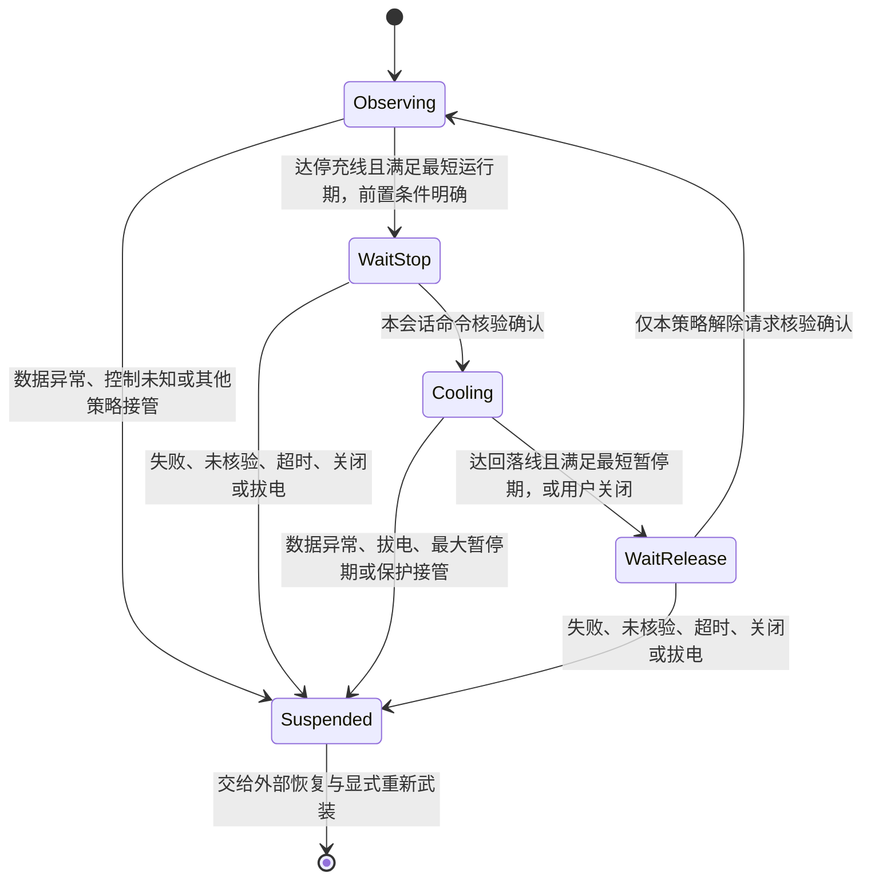

# 温控间歇充电：离线策略与接入条件

当前阶段只实现纯 C 决策模型，不链接 IOKit、Foundation、notify 或文件操作，不调用充电写入，不加入 daemon 构建列表，也未产生新的主包。热模拟真实服务注入暂停，伪造高电量不进入实施。

目标是用较慢、可核验的温度回差决定暂停与解除本策略停充，不宣称连续电流限幅。充电阶段仍可能为较大电流；是否降低温升、保持外部供电和提高可用充入量，必须另做实机对照。

## 模型与状态

源码：`ChargeLimiter/OfflineAdvisory/intermittent_policy.h/.c`。配置显式传入，不提供设备推荐默认值。测试中的温度、保持时间与超时值只是合成夹具，不是实机建议或紧急保护阈值。

`ic_step` 只返回提案。`IC_PROPOSE_RELEASE_OWN` 不是 `setChargeStatus(YES)` 指令；执行层必须先移除本策略的归属，再由统一仲裁器决定是否允许充电。系统保护、容量上限、其他策略和人工暂停均可否决恢复。

命令只提出一次，等待含 session_id 与 command_id 的确认，不按 tick 重写。只有 `IC_CONFIRMED` 能推进到已暂停或已解除；`IC_ACCEPTED_UNVERIFIED`、失败或确认超时都挂起并保留未决义务。后续采样不会自动重新武装。

外部供电断开或功能关闭期间不累计最短运行时间。等待命令确认时若拔电或关闭，会保留未决记录并挂起；迟到确认不能抹去该事件。冷却中用户关闭可以绕过最短暂停期提出自身解除，但不能越过更高优先级保护。

最大暂停时间到期仅发出恢复审查请求，不为了消除停充而在高温下强制恢复。该请求不是自动恢复保障；执行层必须提供可见反馈和恢复入口。进程崩溃时本模型无法运行，仍依赖持久记录和独立恢复路径。

## API 合约

1. 首次使用必须将 `ic_policy` 零初始化，例如 `ic_policy policy = {0};`。`ic_init` 拒绝再次初始化已使用对象，避免清除未决状态。
2. session_id 由外部提供非零、在迟到回调可能存在的范围内不复用的代次；跨进程重启要用持久计数或等价机制，不能固定为 1。模型没有实现持久化或生成代次。
3. `now` 和 `sampled_at` 为同一单调时钟口径；采样时间不可重复、未来或过期。`now` 必须递增；确认时间可与最近一次 step 相同。
4. `recovery_ready` 表示该策略获准新增停充且恢复记录可用；实际停充之前仍须持久化该具体会话/命令的恢复义务，保存失败不得执行。
5. `controls_known_clear` 是清晰核验前置条件；缺字段不等于 true。现有设备曾缺少必要恢复字段，因此目前不能直接据此部署。
6. `IC_CONFIRMED` 必须来自实际执行和对应结果核验，不可用函数返回 0、通知读回、单次正向电流或 App 开关代替。实际充电观察与控制核验依旧分开。
7. 挂起后不存在模型内 reset；外部恢复完成并显式重新武装才可新建对象及新会话。禁止通过 memset/重新分配对象跳过未决恢复。

## 执行层接入前置工作

现有 `setChargeStatus` 与 `setInflowStatus` 是不同路径。前者的代码写入停充属性，不主动调用禁流或写 ExternalConnected；但这不能证明系统供电与握手行为不受影响。间歇策略不得调用禁流路径或通用 `restoreChargeControls` 作为周期性恢复：后者同时解除充电和禁流，会扩大归属范围。

接入前还必须完成：

- 统一停止归属仲裁与会话记录，确认解除自身条件不会覆盖容量上限、紧急温控或用户停止；普通策略读取期间不发生并发写竞争。
- 明确本机可核验的停充与解除证据。现有 CLI 10 仍是未知；不为使模型工作而伪造完整核验。
- 在独立、显式批准的单次停充/恢复实验中确认：外部电源仍被识别，停止阶段没有持续明显负电流或反复握手，解除后实际充电恢复。
- 接通超时审查、daemon 异常后的持久恢复、主开关关闭与卸载提示。日志记录请求、接受、核验、充电观察四层结果。
- 验收基础执行能力后，再决定需要回差间歇还是占空比控制；不直接复用旧 PWM timer 和旧恢复分支。

## 本轮验证

执行 `sh tests/run_intermittent_policy.sh`：严格 C11、Wall/Wextra/Werror 构建，手机独立执行 **225 次断言通过**。仅测试可重复的合成输入，没有真实遥测或硬件操作。

覆盖正常停充/冷却/解除周期、回差与最短保持、关闭交回、保护及其他归属让位、未核验和失败确认、重复/迟到/跨会话确认、命令超时、最大暂停、缺失/过期/重复/未来温度样本、非单调时间、禁用和拔电后重新计时，以及确认等待期间拔电或关闭。独立审查发现的三个时序缺陷均已加入复现回归。

该结果不证明真机降温、充电效率或异常退出后必能恢复。主包仍保持构建 21，不要求用户打开温控、重启服务或安装新包。
